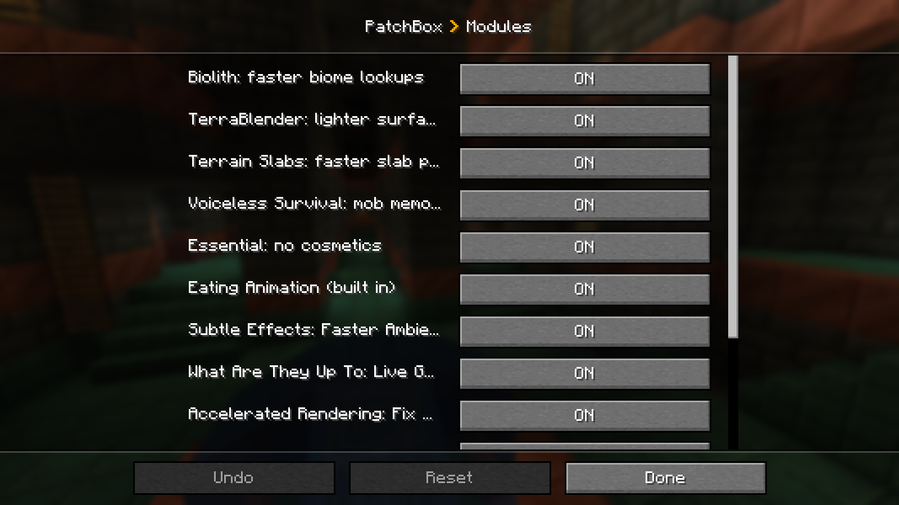

<p align="center"></p>

<p align="center">
  
  
  
  
</p>

**Patchwork** fixes lag, memory leaks and crashes in other popular mods for Minecraft 1.21.1 with NeoForge, without editing or re-uploading their files.

## How it works

- **One module per mod.** Each fix is its own small module, **on by default**.
- **Version-locked.** A module only runs when its target mod is installed at the exact version it was written and tested for. If that mod updates, the module switches itself off and tells you once: *"&lt;Mod&gt; updated, so its fix is off for now. The game works normally."*
- **Nothing required.** None of the target mods are needed. If one isn't installed, its module simply stays off.
- **Your choice.** Every module can be turned off in **Mods → Patchwork → Config** (or `config/patchwork.toml`).

<p align="center"></p>

## What it fixes

| Mod | Version | Fix |
|---|---|---|
| Biolith (in Quark) | 3.0.14 | Biome lookups during world generation without throwaway objects (~163 → ~7 MB/s of garbage) |
| TerraBlender | 4.1.0.8 | No throwaway lambda and second lookup per surface block (~166 MB/s less garbage) |
| Terrain Slabs | 3.1.2 | The slab scan reads each block once (~200 MB/s less garbage) |
| Voiceless Survival | 2.0.1 | Memory leak that kept every mob in memory for the whole session |
| Essential | any | Skips the cosmetics render layer (~61 MB/s render-thread garbage) |
| Eating Animation | replaces it | A Java port (MIT), so Groovy ModLoader isn't needed (~107 MB less RAM) |
| Subtle Effects | 1.15.0 | Per-tick biome checks done once instead of up to five times |
| Accelerated Rendering | 1.0.14-alpha | See-through heads with shader packs |
| What Are They Up To | 1.21.0-1.2.7 | Sharper live GUI previews, smaller network frames, crash-safe decoding (every player needs Patchwork) |
| Supplementaries | 1.21.1-3.9.9 | Wrench crash on blocks without an item (with Quark) |
| Campfire Resting | 1.6.0 | Flood of network errors from players the client can't see |
| Nomadic Tents | 21.1.0 | A mallet on a tent door packs it up instead of teleporting you in; broken recipe unlocks |
| Streams Reflowing | 2.14.4 | Stops chunk-stall thread dumps piling up |
| MidnightLib | 1.9.3 | Random startup crash when two mods load their settings at once |
| Iris | 1.8.14-beta.1 | Shader images start empty instead of with leftover video memory; name tags don't cast floating shadows; rewritten shaders are cached on disk, so the first shader load is faster |
| Load My Chunks | 1.2.5.1 | Endless loop while ticking entities (world freeze, hang on exit) |
| NeoForge jar-in-jar | 21.1.252 | Jars bundled inside mods are read from a disk cache instead of held in memory (~65-117 MB) |
| Villager API | 1.26.9.6 | Finds its villager packs once per world start (~1 s faster world loading) |
| 3D Skin Layers | 1.11.3 | With shaders, the 3D skin layer is drawn flat in the shadow pass (~10% more FPS) |
| Minecraft: sound engine | 1.21.1 | A crashed or stuck sound thread is restarted instead of freezing the game |
| Minecraft: signs | 1.21.1 | Sign text too far away to read (24 blocks, adjustable) isn't drawn (+30% FPS among many signs) |
| Minecraft: render types | 1.21.1 | Render type names built once (~7.5% more FPS near banners with shaders) |
| Seamless Loading Screen | 2.2.1+1.21 | No crash when leaving a world another mod opened |

The performance modules don't change results. Each has a check mode (`-Dpatchbox.verify.<key>=true`) that runs the original code side by side and logs any difference. All were checked on a ~290-mod pack with zero differences.

## Bugs and ideas

Please post them in **[Issues](https://github.com/SteelArchadian/Patchwork/issues)**. That's where every report gets read and tracked, rather than in CurseForge or Modrinth comments.

## Building

Put the compile-only jars listed in `libs/README.txt` into `libs/` (they're the mods' normal releases and aren't included here), then:

```
./gradlew build
```

The jar is written to `build/libs/`. Each module lives in `src/main/java/dev/chill/patchwork/mixin/<key>/` and is registered in `Module.java`.

## Credits and license

Third-party parts keep their own notices, listed in [NOTICE.md](NOTICE.md): small LGPL-derived pieces of Biolith and TerraBlender, and MIT-licensed parts of Terrain Slabs and Eating Animation. Patchwork doesn't include or redistribute any of the mods it patches.

Licensed under the GNU Lesser General Public License v3.0 only: see [LICENSE](LICENSE) (with the GPL text it builds on in [COPYING](COPYING)). Made for the Foundation modpack, with help from Claude.
